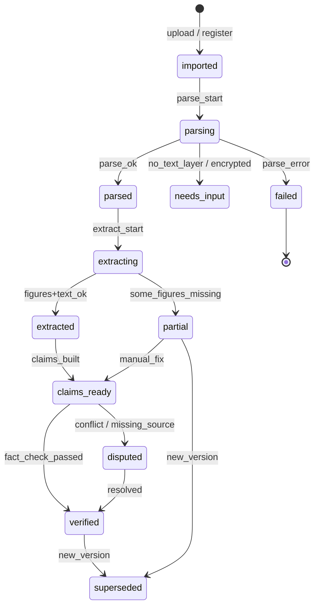
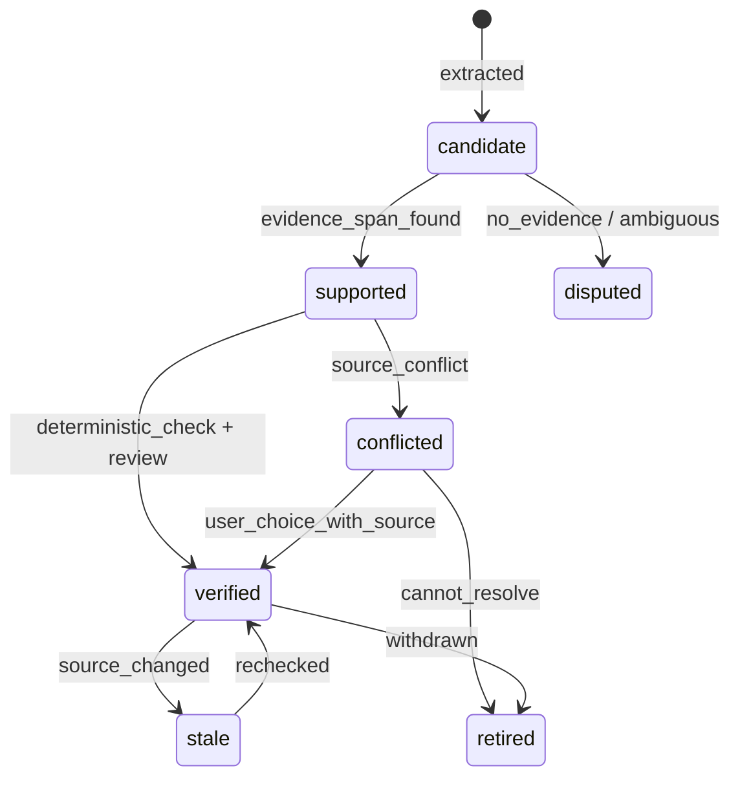
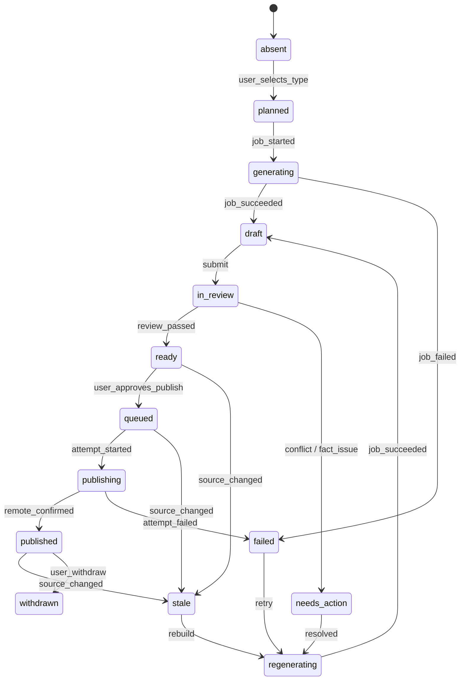
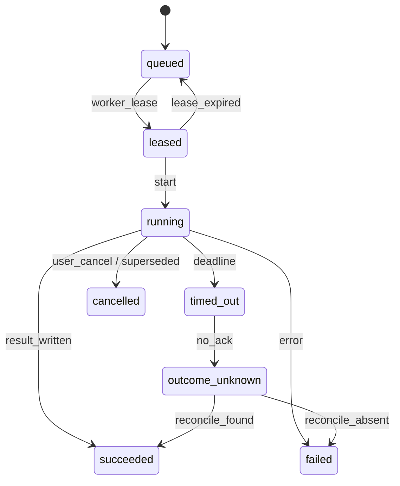
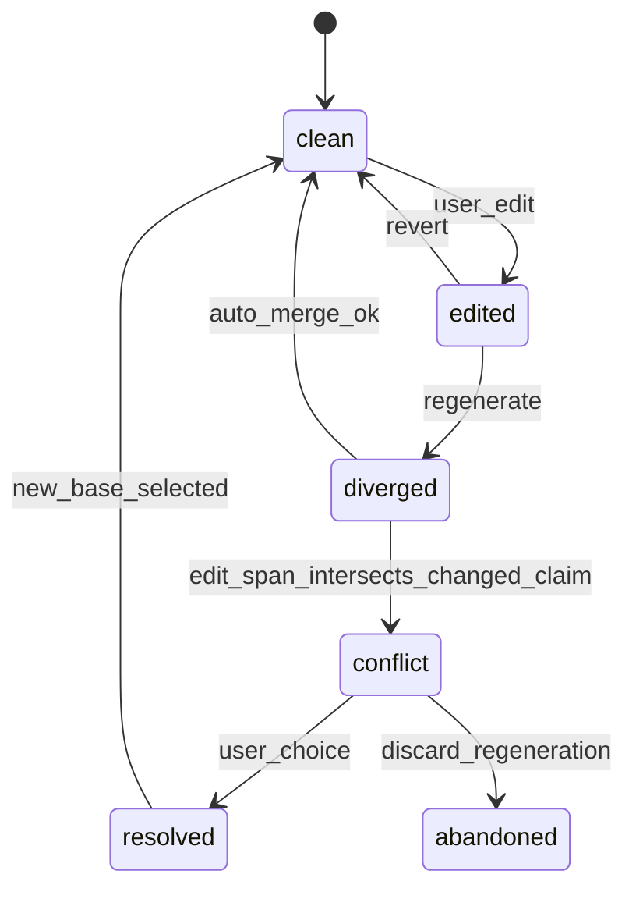
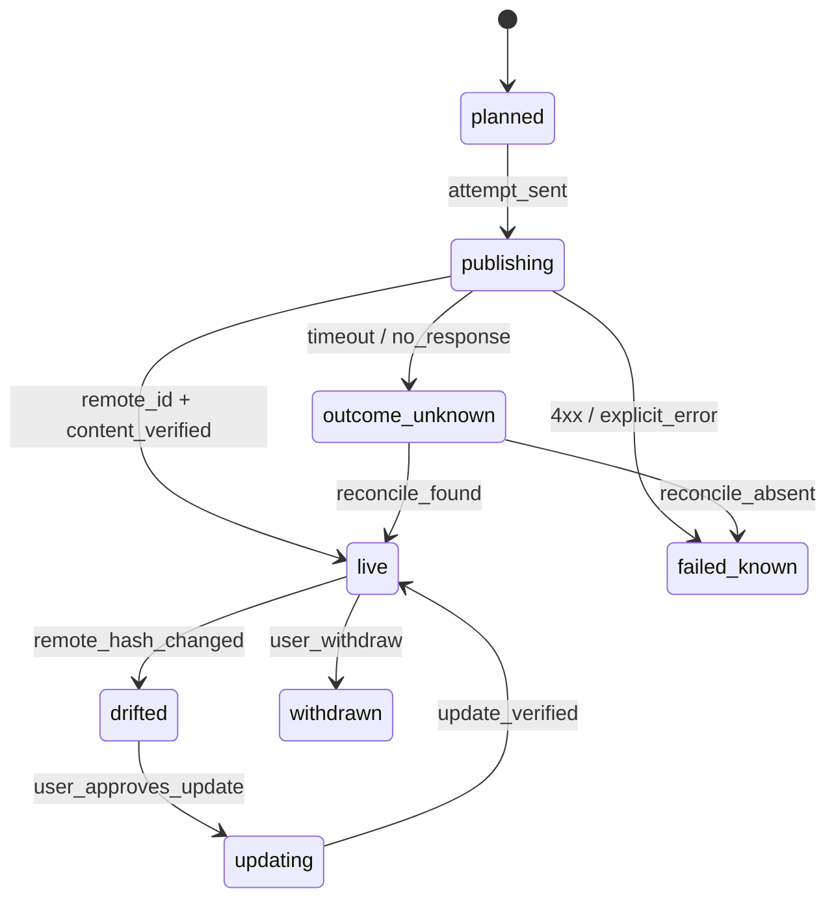
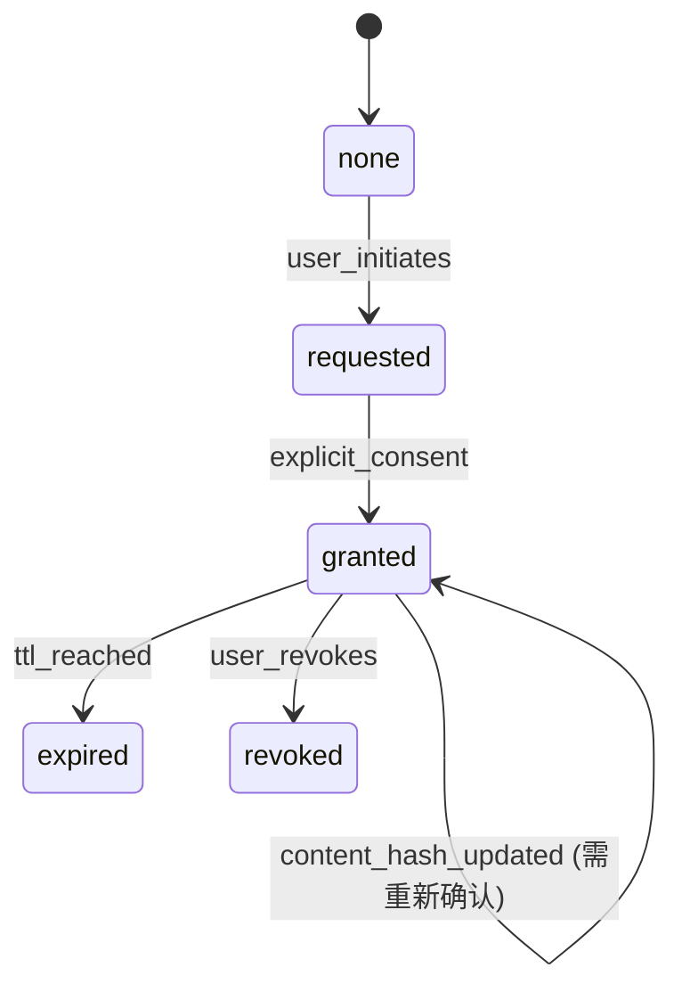
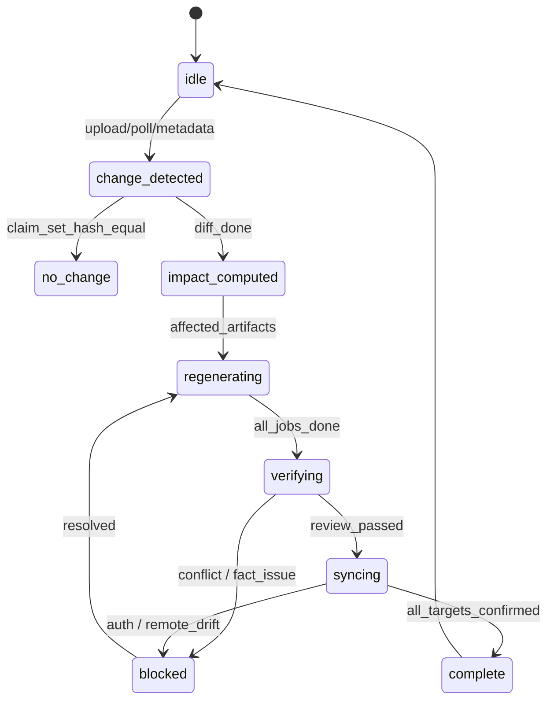
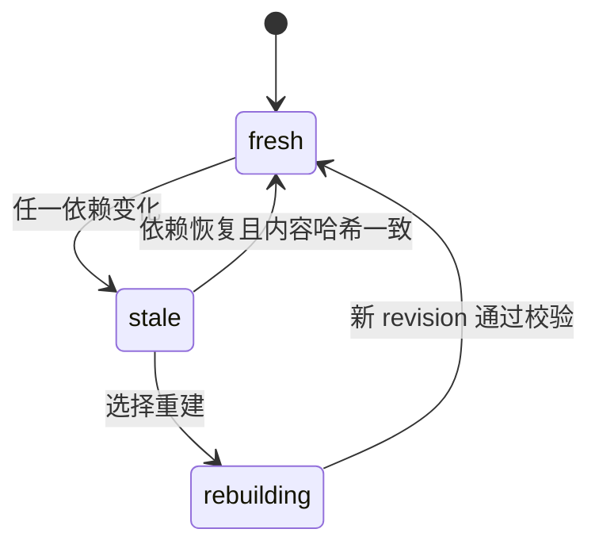

# PaperRelay 隐式状态机清单

日期：2026-11-17
对象：PaperRelay 计划产品（Local Web App + 维护 Agent）
依据：`01_PRODUCT_PLAN.md`、`05_ACCEPTANCE_AND_RELEASE.md`、`06_RUNTIME_PROMPTS.md`、G0 实测证据
说明：**产品尚未实现代码**。以下状态机目前存在于文档语义、UI 步骤、目录/文件存在性和计划中的持久化对象里；本文把它们显式化，供后续设计与实现使用。

---

## 0. 结论摘要

产品里真正危险的不是“生成”，而是**同一份事实在多个产物、多个任务、多个远端目标之间的状态一致性**。按风险排序，最需要先显式化的五个隐式状态机是：

| 排名 | 状态机 | 不显式化会怎样 | 现有证据 |
|---|---|---|---|
| 1 | **PublishAttempt（发布尝试）** | 超时后重试 → 重复发帖；本地成功被当成线上成功 | `05` A8、`06` §6 已要求幂等与“先查远端”，但没有状态模型 |
| 2 | **Artifact staleness（产物过期传播）** | 改了论文数字，海报/视频仍是旧值且无提示 | G0：`paper_spec.md` 25%→30% 后 `poster.html` SHA 不变、无 stale 标记 |
| 3 | **GenerationJob fencing（任务围栏）** | 旧版本任务晚到，覆盖新版本产物 | `01` §7 明确要求，但没有 generation/token 字段 |
| 4 | **Authorization（授权绑定）** | 内容变了仍沿用旧授权，向错误目标发布 | `01` §7、`05` A9 |
| 5 | **EditOverlay（人工编辑叠加）** | 重生成静默覆盖作者修改，或用“保留人工文字”掩盖旧数字 | `01` §7 三方比较要求 |

一句话：**需要一个“事实版本 → 产物版本 → 发布尝试”的单向血缘链，外加每层的显式状态与围栏；不要用一个 `project.status` 概括全部。**

---

## 1. 判定标准与范围

### 1.1 什么算“隐式状态机”

满足以下任一条件，就记为隐式状态机：

- 存在互斥状态，但用多个布尔值表示（`is_stale`、`is_published`、`has_conflict`）。
- 用可空字段表示状态（`published_at != null`、`remote_id`、`error`）。
- 用字符串散落在 UI/日志/模块里（`"draft"`、`"ready"`、`"needs_action"`）。
- 用文件/目录是否存在表示进度（`poster.pdf` 在不在、`assets/` 是否完整）。
- 用 UI 步骤号或进度百分比表示阶段（AutoPR 的 `Step 4/5`）。
- 用重试计数、时间戳、租约推断“是否还在跑”。
- 跨对象的一致性只写在过程代码里，没有不变量与守卫。

### 1.2 范围

- **包含**：产品级对象（PaperVersion、Claim、Artifact、Publication、Job、Authorization、UpdateCampaign）及其子流程。
- **不包含**：第三方渲染器内部（Remotion、pptx2video、LibreOffice）的私有状态；只保留它们与本产品的集成边界状态（如 `render_qa_passed`）。
- **粒度**：一个状态机 = 一个聚合根（aggregate）的合法状态集合 + 迁移。子阶段（TTS、字幕、渲染）作为独立小机器列出，但不与产物生命周期混为一个 enum。

### 1.3 状态所有权

| 层 | 权威来源 | UI 的角色 | 备注 |
|---|---|---|---|
| 事实/版本 | 本地 SQLite + 源文件哈希 | 展示与确认 | 不可由 UI 本地状态推断 |
| 产物/任务 | 本地 SQLite + 队列 | 展示进度、触发动作 | 进度不是状态 |
| 远端发布 | 远端 API + 本地镜像 | 展示 `last_verified_at` | 本地成功 ≠ 线上成功 |
| 授权 | 本地策略表 | 展示范围与到期 | 绑定目标与内容哈希 |

---

## 2. 状态机全景（26 个）

### A. 真相层（事实与来源）

| ID | 状态机 | 状态 | 主要事件 | 当前隐式载体 | 关键风险 |
|---|---|---|---|---|---|
| S01 | Project | new → initializing → ready → active → paused → archived → deleted | create / deps_ok / open / close / archive / delete | 目录存在、`project.json` | 删除/归档时仍有任务在跑 |
| S02 | PaperVersion | imported → parsing → parsed → extracting → extracted → claims_ready → verified → superseded / failed / needs_input | upload / parse_ok / partial / extract_ok / claims_built / verify / new_version / fail | “材料版本与状态”一句话；文件副本 | 部分解析被当成功；新版本与旧任务并发 |
| S03 | IngestJob | queued → running → succeeded / partial / failed / cancelled | start / progress / done / error / cancel | 进度、临时文件 | 重启后不知道做到哪 |
| S04 | Claim | candidate → supported → disputed → conflicted → verified → stale → retired | extract / evidence_found / evidence_missing / source_conflict / verify / source_change / retire | `claims[]` 数组 + 自由文本 | 无证据也算支持；冲突被合并成一个值 |
| S05 | ClaimSetSnapshot | draft → frozen → verified → superseded | build / freeze / verify / new_version | 无独立对象 | 产物引用了“最新 claims”，而不是快照 |
| S06 | VenueStatus | unknown → preprint → submitted → accepted → published（另 workshop/main、camera_ready 维度） | user_confirm / source_found / status_change | `venue` 字符串 | 从文件名/模型知识推断接收状态 |
| S07 | FigureAsset | discovered → extracted → cleaned → approved → embedded / missing / duplicate / rejected | detect / crop / clean / approve / embed / miss | `assets/figures/` 文件存在 | 漏图、裁到邻栏、重复图 |

### B. 生产层（生成与编辑）

| ID | 状态机 | 状态 | 主要事件 | 当前隐式载体 | 关键风险 |
|---|---|---|---|---|---|
| S08 | Artifact | absent → planned → generating → draft → in_review → ready → queued → publishing → published → stale → regenerating / failed / needs_action / withdrawn | plan / generate / submit_review / approve / queue / publish_ok / source_change / fail / withdraw | `draft/ready/published/stale` 散落 | 一个 `is_published` 掩盖多产物差异 |
| S09 | ArtifactRevision | candidate → selected → superseded | create / select / replace | 文件覆盖、无版本号 | 无法回滚；旧候选仍可发布 |
| S10 | GenerationJob | queued → leased → running → succeeded / failed / timed_out / outcome_unknown / cancelled | enqueue / lease / start / finish / timeout / cancel | 任务 ID + 进度 | 旧任务晚到覆盖新版本；无限重试 |
| S11 | EditOverlay | clean → edited → diverged → conflict → resolved / abandoned | user_edit / regenerate / merge / resolve | 直接改产物文本 | 重生成覆盖人工修改 |
| S12 | Review | not_run → auto_running → auto_passed / auto_failed → human_pending → human_passed / human_rejected / waived | start / auto_verdict / request_human / verdict / waive | `issues[]`、日志 | 自动通过被当成发布许可 |
| S13 | Staleness | fresh → stale(reason) → rebuilding → fresh | source_change / impact / rebuild / verify | 无字段；靠人记得 | 产物显示旧数字且无提示 |
| S14 | VideoPipeline | outline → script → scenes → tts → subtitles → render → qa → export（每段可 partial/failed） | author / synthesize / render / qa / export | 文件是否生成 | 只有分镜/无声 MP4 被当完成 |
| S15 | ModelCall | idle → calling → retry_backoff → fallback → succeeded / failed / budget_exhausted | call / rate_limit / error / fallback / budget | 日志、异常 | 不知道实际 provider/费用；重试烧额度 |

### C. 分发层（发布与维护）

| ID | 状态机 | 状态 | 主要事件 | 当前隐式载体 | 关键风险 |
|---|---|---|---|---|---|
| S16 | PublishTarget | unconfigured → configured → verified → authorized → blocked / revoked | configure / verify / grant / block / revoke | 渠道表、凭证是否存在 | 把“有 token”当“可发布” |
| S17 | Publication | absent → planned → publishing → live → drifted → updating → failed → withdrawn | plan / send / confirm / drift / update / fail / withdraw | `remote_id`、`published_at` | 本地成功被当线上成功 |
| S18 | PublishAttempt | prepared → sent → confirmed / failed_known / outcome_unknown → reconciled / duplicate_blocked | prepare / send / ack / timeout / reconcile | 请求日志 | 超时重试造成重复发帖 |
| S19 | Authorization | none → requested → granted → expired / revoked | request / grant / expire / revoke | 用户口头/设置页 | 内容变了仍沿用旧授权 |
| S20 | RemoteDrift | clean → detected → decision_pending → accept_remote / overwrite / merge → resolved | compare / detect / decide / apply | 远端内容未缓存 | 覆盖远端人工修改 |
| S21 | UpdateCampaign | idle → change_detected → no_change / impact_computed → regenerating → verifying → syncing → complete / blocked | detect / diff / impact / rebuild / verify / sync | 一次“更新”操作 | 重复生成、重复发布、半更新 |
| S22 | SocialCorrection | none → needed → draft_ready → manual_synced / ignored | detect_old_post / draft / confirm | 无记录 | 旧帖无法编辑却声称已更新 |

### D. 运行时层

| ID | 状态机 | 状态 | 主要事件 | 当前隐式载体 | 关键风险 |
|---|---|---|---|---|---|
| S23 | DependencyReadiness | unknown → checking → ready / missing / unhealthy | check / probe / fail | 启动检查日志 | 缺 LibreOffice/ffmpeg 到生成时才报错 |
| S24 | QueueWorker | pending → leased → running → acked / nacked / lease_expired | enqueue / lease / ack / nack / expire | 内存队列 | 重启丢任务、双 worker 抢同一任务 |
| S25 | ErrorBlocker | none → retryable → needs_action → fatal | classify / retry / resolve | 异常字符串 | 环境错误被写成产品缺陷，或反之 |
| S26 | NotificationItem | open → acknowledged → resolved / dismissed | create / ack / resolve | UI 提示 | 冲突/过期提示丢失 |

---

## 3. 核心状态机详解

### S02 PaperVersion：一切血缘的起点



**必须显式化的字段**

- `source_hash`（文件内容 SHA256，不可变）
- `status`（上面的 enum）
- `superseded_by`（新版本 ID）
- `parse_coverage`（页数/图数/字符数，用于识别 partial）
- `claim_set_hash`（指向 S05 快照）

**不变量**

1. 一个项目同时只有一个 `current` 版本。
2. `source_hash` 相同的重复上传不创建新版本。
3. `verified` 只能由 S12 的通过结果进入，不能由 UI 直接设置。
4. 新版本创建后，旧版本的 `ready/queued` 产物立即失效（见 S13）。

**当前隐式点**：文档只写“材料版本与状态”，没有定义 `partial` 与 `verified` 的区别；G0 里 ResearchStudio 的“提取完成”实际漏了 Figure 6，说明“跑完脚本”不等于 `extracted`。

---

### S04 Claim：事实的最小单元



**字段**

`id, paper_version_id, key, value, unit, baseline, comparison_type, dataset_or_setting, source_span, source_kind, status, supersedes_claim_id`

**不变量**

1. `supported` 必须有真实存在的 `source_span`（页码 + 原句/图表 ID）。
2. 相对提升与百分点、最高值与均值、模拟与实测必须分开存，不能只存一个字符串。
3. 来源冲突时保留候选值与出处，不合并成一个“新事实”。
4. `stale` 的 Claim 不能被任何 `ready` 产物引用。

**当前隐式点**：`claims[]` 数组没有状态；PromoAgent 的“70%”、AutoPR 的 95%/80% 说明缺少“无证据即不可用”的门。

---

### S08 Artifact：每个产物一个状态机，不是一个项目一个



**关键区分**

- `ready` = 内容可发布，但还没发。
- `queued` = 已获授权、等待发布动作。
- `published` = 远端已确认（有 `remote_id` + 内容校验）。
- `stale` = 依赖的 Claim/版本已变；**不是**“需要人工看一眼”。
- `needs_action` = 有明确阻塞（冲突、缺权限、远端漂移），需要人决定。

**不变量**

1. `ready` 的前提：引用的所有 Claim 为 `verified` 且未 stale；S12 通过；`content_hash` 与当前 `ClaimSetSnapshot` 一致。
2. `published` 的前提：`Publication.state == live` 且 `remote_content_hash == approved_hash`。
3. `stale` 会递归使下游 `Publication` 进入 `drift/update_pending`，但不删除历史。
4. 一个产物的失败不改变其他产物的状态；项目级“完成度”是派生值。

**当前隐式点**：`01` 只给了 `draft → ready → queued → published` 和 `failed/needs_action/stale`；没有定义 `publishing` 与 `published` 的区别，也没有 `regenerating/withdrawn`。

> 注意：`Artifact.publishing` 只是 UI 投影；**远端权威状态在 S17 Publication / S18 PublishAttempt**。两者不能各自维护一份“已发布”。

---

### S10 GenerationJob：必须有围栏，否则旧任务会覆盖新版本



**字段**

`id, project_id, kind, input_hash, source_version_id, generation, attempt, lease_until, status, result_ref`

**围栏规则**

```text
accept(result) iff
  job.generation == artifact.current_generation
  AND job.source_version_id == project.current_version_id
  AND job.input_hash == artifact.expected_input_hash
否则丢弃结果，记录 superseded_result（不写产物、不标 ready）。
```

**不变量**

1. 同一 `input_hash` 的重复触发直接复用结果，不重复调用模型。
2. 自动重试最多 2 次；超过进入 `needs_action`。
3. 任务结果写回是幂等的（按 `job.id` 去重）。
4. 取消不是删除：保留审计记录。

**G0 对应**：ResearchStudio 的更新实验里，`poster.html` 没有重生成也没有 stale 标记——正是缺少“源版本变化 → 产物围栏/失效”的后果。

---

### S11 EditOverlay：人工修改不是“改文件”，是叠加层



**字段**

`id, artifact_id, base_revision_id, diff, author, created_at, status`

**不变量**

1. 重生成永远产生新的 `ArtifactRevision`，不覆盖已有 revision。
2. 人工编辑按 `base_revision_id` 做三方合并；不能把“保留人工文字”当作“事实仍最新”。
3. 若人工段落包含旧 Claim 值，必须标 `conflict`，即使文字本身被保留。
4. 发布时使用 `selected_revision + overlay` 的合成结果，并记录合成哈希。

**当前隐式点**：`01` §7 要求“保存上一次基准稿、用户编辑和新候选稿，进行最小三方比较”，但没有 `overlay` 对象；实现时很容易退化成直接改文本。

---

### S17 + S18 Publication / PublishAttempt：本地成功不等于线上成功



**PublishAttempt 子状态**

`prepared → sent → confirmed / failed_known / outcome_unknown → reconciled / duplicate_blocked`

**幂等键**

```text
idempotency_key = hash(project_id, source_version_id, artifact_revision_id,
                       target_id, action, approved_content_hash)
```

**不变量**

1. 只有拿到真实远端 ID 且内容校验通过，才写 `live`。
2. `outcome_unknown` 禁止直接重试；先按幂等键/远端列表核对。
3. 源版本变化但 `approved_content_hash` 未变 → 不重复发布。
4. 同一目标同一时刻只允许一个 `publishing` attempt（per-target mutex）。
5. `drifted` 时自动更新默认关闭，需人决定覆盖/合并/保留远端。

**当前隐式点**：`06` §6 已写规则，但没有 attempt 表；实现时容易用“请求成功”直接写 `published`。

---

### S19 Authorization：授权必须绑定“目标 + 动作 + 内容”



**字段**

`id, target_id, actions[], content_hash, scope, granted_at, expires_at, state`

**不变量**

1. 授权至少绑定：目标（repo/path/account）、动作（create/update/post）、内容哈希或版本。
2. 内容哈希变化 → 旧授权不可直接复用；需要新的确认（可批量，但不能静默）。
3. 删除/撤回授权立即阻止新 attempt；已发出的请求进入 `outcome_unknown` 核对。
4. 凭证存在 ≠ 授权存在；凭证只决定“能不能”，授权决定“允不允许”。

---

### S21 UpdateCampaign：一次“更新”是一个可审计的流程



**不变量**

1. `no_change` 不调用模型、不发布。
2. 影响面按 Claim → Artifact → Publication 的血缘计算，不按“文件时间”猜。
3. 部分产物失败时，campaign 不能标 `complete`；逐产物报告。
4. 同一项目同时只有一个 campaign；新触发合并到当前 campaign。
5. 重启后从持久化状态恢复，不从头重跑。

**G0 对应**：现有 ResearchStudio 的更新只重建素材，`poster.html` 不更新、无 stale 标记；AutoPR/PromoAgent 没有 campaign 概念。

---

### S13 Staleness：派生状态，不是布尔字段



**依赖边**

```text
PaperVersion --hash--> ClaimSetSnapshot --claim_ids--> ArtifactRevision
ArtifactRevision --content_hash--> Publication
Claim --supersedes--> Claim
```

**规则**

- `stale` 是**计算出来的**：`artifact.used_claim_ids` 中任一 Claim 不是 `verified`，或 `source_version != current`，或 `content_hash != expected`。
- 不要存 `is_stale` 布尔值；存 `stale_reason[]` 与 `computed_at`。
- 下游 `Publication` 的过期由 Artifact 过期派生，并保留“线上仍是旧版”的事实。

---

## 4. 跨状态机不变量（实现时必须写成断言/约束）

| ID | 不变量 | 违反后的表现 |
|---|---|---|
| INV-01 | 每个 Claim 的 `source_span` 必须真实存在 | 编造数字（PromoAgent 70%） |
| INV-02 | `Artifact.ready` ⇒ 所有引用 Claim 为 `verified` 且非 stale | 旧数字被发布 |
| INV-03 | `ArtifactRevision` 不可变；修改产生新 revision | 无法回滚/审计 |
| INV-04 | Job 结果只在 generation + source_version + input_hash 匹配时接受 | 旧任务覆盖新版本 |
| INV-05 | `Publication.live` ⇒ 有远端 ID 且远端内容哈希匹配 | 假成功 |
| INV-06 | `PublishAttempt` 以幂等键去重；unknown 不盲目重试 | 重复发帖 |
| INV-07 | Authorization 绑定目标/动作/内容哈希 | 向错误目标发布 |
| INV-08 | 人工编辑以 overlay 保存，不被静默覆盖 | 作者修改丢失 |
| INV-09 | 内容哈希未变 → 不重生成、不重发布 | 重复花费/重复发帖 |
| INV-10 | 一个产物的失败不改变其他产物状态 | 全量回滚或假完成 |
| INV-11 | 远端漂移时默认不自动覆盖 | 覆盖远端人工修改 |
| INV-12 | 重启后所有 `running` 任务可恢复或安全失败 | 任务丢失/双跑 |

---

## 5. 竞态清单

| ID | 场景 | 错误结果 | 守卫 |
|---|---|---|---|
| R1 | v2 上传时 v1 视频仍在渲染 | v1 结果写成当前产物 | generation fence + source_version 校验 |
| R2 | 旧 Job 在新 revision 之后完成 | 覆盖新内容 | `job.generation != current` → 丢弃 |
| R3 | 发布请求超时后用户重试 | 重复帖子 | idempotency_key + 先 reconcile |
| R4 | 重生成时用户正在编辑 | 编辑丢失 | overlay + 三方合并 + 冲突状态 |
| R5 | 同一目标两个发布并发 | 远端冲突/重复 | per-target mutex |
| R6 | 轮询在 campaign 进行中再次触发 | 重复生成 | campaign 单例 + 触发合并 |
| R7 | 服务重启时 Job 在跑 | 永久 running | lease + 启动恢复扫描 |
| R8 | 发布时远端被人修改 | 覆盖他人修改 | ETag/hash compare-and-swap + drift |
| R9 | 冲突解决时旧 Job 完成 | 旧候选复活 | revision/generation 校验 |
| R10 | 删除项目时任务仍在跑 | 写入已删目录 | tombstone + cancel + 写前校验 |

---

## 6. 最小显式模型（建议直接落到 SQLite）

只建以下表即可覆盖上述 26 个状态机的主干；不需要通用工作流引擎。

```sql
projects(id, name, root_path, status, created_at)
paper_versions(id, project_id, source_hash, status, superseded_by, created_at)
claim_snapshots(id, paper_version_id, claim_set_hash, status, created_at)
claims(id, snapshot_id, key, value, unit, baseline, comparison_type,
       dataset_or_setting, source_span, status, supersedes_id)
artifacts(id, project_id, type, locale, current_revision_id, status, stale_reason_json)
artifact_revisions(id, artifact_id, source_version_id, claim_set_hash,
                   content_hash, state, created_at)
edit_overlays(id, artifact_id, base_revision_id, diff, author, status)
jobs(id, project_id, kind, input_hash, source_version_id, generation,
     attempt, lease_until, status, result_ref)
reviews(id, artifact_revision_id, kind, verdict, evidence_json)
publish_targets(id, project_id, kind, locator, capability, state, verified_at)
publications(id, target_id, artifact_id, remote_id, remote_version,
             remote_hash, state, last_verified_at)
publish_attempts(id, publication_id, approved_content_hash,
                 idempotency_key, state, response_json, created_at)
authorizations(id, target_id, actions_json, content_hash, scope,
               granted_at, expires_at, state)
update_campaigns(id, project_id, from_version_id, to_version_id,
                 state, impact_json, created_at)
state_transitions(id, entity_type, entity_id, from_state, to_state,
                  event, actor, at, evidence_json)
```

### 6.1 迁移函数示例

```text
function can_mark_ready(artifact):
  rev = artifact.current_revision
  return rev.claim_set_hash == current_snapshot.hash
     and all(claim.status == verified and not claim.stale for claim in rev.claims)
     and review(rev).verdict == passed
     and not has_open_conflict(artifact)

function accept_job_result(job, artifact):
  return job.generation == artifact.generation
     and job.source_version_id == project.current_version_id
     and job.input_hash == artifact.expected_input_hash

function can_publish(artifact, target, auth):
  return artifact.status == queued
     and artifact.content_hash == auth.content_hash
     and target.state == authorized
     and now < auth.expires_at

function reconcile_publish(attempt):
  remote = target.find_by_idempotency_key(attempt.idempotency_key)
  if remote.exists: return CONFIRMED(remote.id)
  if attempt.state == outcome_unknown: return UNKNOWN  # 禁止直接重试
```

### 6.2 派生视图

- `artifact.readiness` = 由 Claim 状态、Review、冲突、依赖派生，不落库。
- `project.progress` = 各 Artifact 状态的聚合，不落库。
- `publication.is_current` = `remote_hash == artifact.content_hash`，不落库。

---

## 7. 优先级与落地顺序

| 优先级 | 先做哪些 | 理由 |
|---|---|---|
| **P0** | S18 PublishAttempt、S19 Authorization、S10 Job fence、S13 Staleness、S11 EditOverlay | 直接决定“会不会重复发/发错/覆盖/丢修改”，也是 `05` A7/A8 的硬条件 |
| **P1** | S04 Claim、S08 Artifact、S12 Review、S17 Publication、S21 UpdateCampaign | 决定事实正确性与更新闭环 |
| **P2** | S02/S03/S05/S06/S07、S20 RemoteDrift、S22 SocialCorrection | 决定来源质量与渠道维护 |
| **P3** | S14 VideoPipeline、S15 ModelCall、S23–S26 | 运行时健壮性与可诊断性 |

**实现顺序建议**

1. 先建 `state_transitions` 事件表 + 每个聚合的 enum/守卫（不写 UI）。
2. 再做 `PaperVersion → Claim → ArtifactRevision` 的血缘与哈希。
3. 再做 Job fence 与 queue lease。
4. 再做 PublishAttempt 幂等与 reconcile。
5. 最后接 UI；UI 只读状态与发命令，不自己推断状态。

---

## 8. 反模式清单

| 反模式 | 为什么危险 | 替代 |
|---|---|---|
| 一个 `project.status` 概括所有产物 | 无法表达“文案已发、视频过期、主页待更新” | 每产物一个状态机 + 派生聚合 |
| `is_published` 布尔值 | 无法区分 queued/publishing/live/drifted | Publication + PublishAttempt |
| `is_stale` 布尔值 | 丢失原因与影响面 | 派生 stale_reason[] + 依赖边 |
| 用文件存在表示完成 | 半成品/空文件被当成功 | 状态字段 + 校验哈希 |
| 用 UI 步骤号表示状态 | 重启/刷新后丢失 | 后端状态 + 进度仅展示 |
| 超时即重试 | 重复发帖/重复扣费 | idempotency_key + reconcile |
| 直接改产物文本 | 覆盖人工修改 | EditOverlay + 三方合并 |
| 用“保留人工文字”证明“事实最新” | 旧数字被保留 | 冲突标记 + Claim 校验 |
| 源版本变了就全量重生成 | 浪费模型调用 | content_hash 无变化则 no_change |

---

## 9. 与 G0 实测的对应

| G0 观察 | 对应的缺失状态机 |
|---|---|
| ResearchStudio 改 25%→30% 后 `poster.html` SHA 不变、无 stale 标记 | S13 Staleness、S21 UpdateCampaign |
| AutoPR UI 显示 `Step 4/5 70%`，崩溃后无恢复 | S10 GenerationJob、S24 QueueWorker、S25 ErrorBlocker |
| PromoAgent 生成“70%/80%/95%/3×”等无来源数字 | S04 Claim（无证据门）、S12 Review |
| Paper2All 用输出目录/脚本退出码表示成功 | S03 IngestJob、S08 Artifact |
| paper2anything 无 token 直接 401 | S23 DependencyReadiness、S25 ErrorBlocker |
| 海报写 ICLR 2022 但无来源 | S06 VenueStatus、S04 Claim.source_span |

---

## 10. 一页总结

- 产品至少有 **26 个**需要显式化的状态机；其中 **5 个 P0** 决定发布安全与人工修改是否丢失。
- 核心不是“状态多”，而是**血缘 + 围栏 + 幂等 + 派生过期**四件事。
- 最小实现：一张 `state_transitions` 事件表、每个聚合一个 enum、五个守卫函数（ready/publish/accept_job/auth/reconcile）、一个内容哈希体系。
- 不要建通用工作流引擎；用 SQLite + 明确 enum + 纯函数守卫即可。
- 在写第一行 UI 之前，先把 S02/S04/S08/S10/S11/S13/S17/S18/S19 的字段与迁移定下来；否则后面会在 UI 里补状态，必然出现“看起来成功、实际不一致”。
