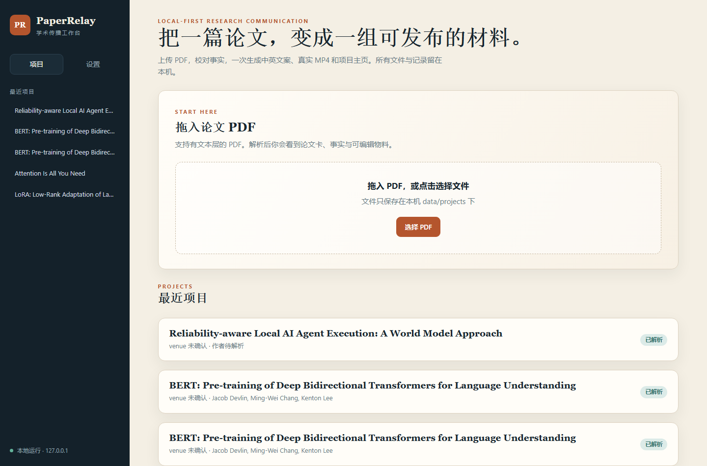

# PaperRelay

**Local-first 学术传播工作台。** 上传一篇论文 PDF，在本机生成中英文宣传文案、带旁白与字幕的 MP4、可部署的项目主页，并用传播矩阵跟踪每个物料的状态与过期情况。

**English:** PaperRelay is a local-first research communication workspace. Upload a paper PDF and produce bilingual promotional copy, a narrated MP4 with subtitles, a deployable project page, and a status matrix — all on your machine.

> Version: `0.1.0`

> 这是可运行的本地 Web App，不是静态演示。所有记录保存在 `data/`，服务只绑定 `127.0.0.1`。



## 快速开始

所有命令都在**仓库根目录**执行（即包含 `backend/`、`frontend/`、`run.py` 的目录）。

要求：Python 3.11+；视频需要本机 `ffmpeg`/`ffprobe`；文案生成需要一个 OpenAI 兼容端点（默认本机 Ollama，可选）。

```powershell
python -m venv .venv
.\.venv\Scripts\python.exe -m pip install -r requirements.txt
.\.venv\Scripts\python.exe -m playwright install chromium
.\.venv\Scripts\python.exe run.py
```

Windows 也可以直接运行：

```powershell
.\start.ps1
```

打开 http://127.0.0.1:8787/ 。

### 实测环境（2026-11-20，Windows 11）

| 组件 | 版本 |
|---|---|
| Python | 3.11.18 |
| FastAPI / Uvicorn | 0.164.0 / uvicorn[standard] |
| PyMuPDF | 2.1.0 |
| Pillow | 13.0.0 |
| edge-tts | 7.3.1 |
| Playwright + Chromium | 1.65.2 / 随 Playwright 安装 |
| FFmpeg / FFprobe | 系统安装，程序自动查找 PATH 或 `FFMPEG_BIN` / `FFPROBE_BIN` |
| 可选 LLM | Ollama（chat 协议）或 Magpie 网关（responses 协议） |

`start.ps1` 会检查已有虚拟环境是否缺少依赖或 Chromium，缺什么装什么；它不会删除你的 `data/` 或数据库。

### 模型

默认连接本机 Ollama 的 OpenAI 兼容端点：

- Base URL: `http://127.0.0.1:11434/v1`
- Model: `qwen2.5:7b-instruct`
- API Key: 任意非空值（Ollama 不校验）

“设置”页支持两种协议，可按网关切换：

| API 协议 | 路径 | 适用 |
|---|---|---|
| `chat` | `/v1/chat/completions` | Ollama、OpenAI、vLLM |
| `responses` | `/v1/responses` | Magpie 等只提供 Responses API 的网关 |

例如本机 Magpie 网关：Base URL `http://127.0.0.1:3425/v1`，协议 `responses`，模型填 `group/...` 或具体模型 id。保存后点“测试连接”，会显示实际可用的协议。

模型不可用时，文案会退回**基于 PDF 候选事实与已确认元数据的确定性模板**，并明确标注 `llm_unavailable`，不会伪造模型成功。模板只使用比较型/结果型数值（例如“3× 更快”“28.4 BLEU”），模型大小这类无比较语境的数值不会被当成结果。

### 视频

需要 `ffmpeg` 与 `ffprobe`。程序会依次查找 `FFMPEG_BIN`、PATH、常见 conda 路径。视频由本机渲染：

- 5 个场景、1920×1080、H.264/AAC
- Edge TTS 旁白（需要网络）；设置页可选 English / 中文，中文默认 `zh-CN-XiaoxiaoNeural`
- 烧录字幕 + 单独 SRT/VTT
- 论文原图（从 PDF 裁切）或版式化文字背景
- 最终 MP4 用 `ffprobe` 回读；超过 120 秒时按比例加速到约 115 秒，SRT 时间同步缩放
- 生成失败时保留旧 MP4 不覆盖，任务显示真实错误并可重试

如果 Playwright Chromium、Edge TTS 或 FFmpeg 缺失，任务会显示具体错误与安装提示，不会生成空 MP4。

## 已实现

| 模块 | 行为 |
|---|---|
| 论文导入 | 拖入 PDF，PyMuPDF 解析文本/图/链接；自动核对 Semantic Scholar、arXiv、OpenAlex 的 title/authors/abstract/venue；**OpenReview 不做自动查询**，仅在用户填写 venue 来源时记录其 URL |
| 事实 | 自动抽取带页码与原句的**候选数值事实**（状态 `candidate`，过滤无比较语境的模型大小），可在论文卡逐条标记 `verified`；venue 必须有来源才算确认；代码链接自动抽取后需用户确认归属；文案生成后做数字/venue/代码链接对照，问题进入 `needs_review` |
| 文案 | X 英文/中文、LinkedIn、公众号、小红书；可编辑、保存、重新生成、候选稿并排对比与采用、标记可发布 |
| 视频 | 真实 MP4 + 旁白 + 字幕 + SRT；可重新生成 |
| 项目主页 | 响应式 `index.html` + assets + BibTeX + 视频；本地预览与 ZIP 导出 |
| 传播矩阵 | 每个物料的 absent/generating/draft/needs_review/ready/stale/failed 状态；来源登记与立即检查 |
| 维护 | 定时检查 arXiv / GitHub / 本地文件 / URL；变化后把已生成物料标为 stale，并自动准备文案与主页的更新候选（人工稿保留，候选进入待审核） |
| 发布 | GitHub Pages 适配器；必须显式勾选批准；服务端校验版本、物料状态与事实问题；推送后轮询 Pages 构建并实际请求 URL，只有页面真实可访问才标记 `live`，否则记为 `pending_verification` |
| 持久化 | SQLite + 项目目录；服务重启后项目、草稿、文件仍在；运行中的任务会标为 interrupted 并可重试 |

## 明确未实现 / 边界

- 微信、小红书没有稳定的个人自动发布接口：只提供文案与复制/导出，传播矩阵里明确标为“手动发布”，不声称自动发布。
- X/LinkedIn/Bluesky 的真实 API 发布未接入；传播矩阵里明确标为“手动发布”。
- 视频支持英文与中文两种旁白；中文脚本只使用已确认标题/作者/venue、候选数值 claim 和链接，不翻译或补写论文未提供的方法细节。
- GitHub Pages 发布需要 `gh` 已登录且用户批准；Pages 生效需要时间，发布结果会提示去浏览器核对。
- 不复制 Paper2All 代码（根目录无明确 LICENSE）；复用 ResearchStudio 的设计思路与公开方法，未直接复制其源码。
- 扫描件/OCR 不在首版；无文本层会提示重传。

## 架构

```
frontend/ (vanilla SPA)
   │  fetch /api
backend/main.py (FastAPI, 127.0.0.1)
   ├── extract.py      PDF → text / figures / claims
   ├── metadata.py     Semantic Scholar / arXiv / OpenAlex（不含 OpenReview 自动查询）
   ├── generate.py     LLM copy + deterministic fact check
   ├── video.py        Playwright slides + Edge TTS + ffmpeg
   ├── site.py         responsive project page + BibTeX
   ├── maintenance.py  scheduled source checks → stale
   ├── github_publish.py  approved Pages publish
   └── db.py           SQLite state machines
```

状态机背景见项目根目录的 `IMPLICIT_STATE_MACHINES.md`（交接包中随附），不是运行时框架：本版本只实现上传、事实确认、物料生成、审核、候选对比、来源变化与发布门禁所需的状态。

## 安全

- 仅绑定 `127.0.0.1`。
- PDF 文本作为不可信数据；不执行其中的指令。
- 文件名取 basename，项目目录由服务生成。
- API key 只存本地 SQLite，设置接口返回掩码。
- 导出 ZIP 不含数据库与凭证。
- 发布必须显式 `approve=true`。

## 许可与归属

自有代码 MIT。第三方依赖与设计参考见 `THIRD_PARTY.md`；再分发前必须阅读 `THIRD_PARTY_LICENSES.md`（PyMuPDF AGPL/商业、edge-tts LGPL-3.0）。论文样本仅用于本地测试；公开示例需自行确认再分发权限。
